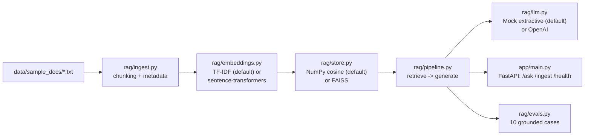

# Fin LLM Research Agent

A retrieval-augmented financial research agent over earnings calls and
filings. Ask a question, get an answer **grounded in retrieved chunks,
with citations** — or an explicit refusal when the documents do not
contain the answer. No hallucinated numbers.

Built as a portfolio project for Forward Deployed Engineer / AI Engineer
roles: it shows RAG, evaluation, and production engineering (API, tests,
CI, Docker), not a notebook demo.

## What it does

- Ingests `.txt` / `.md` documents (earnings calls, 10-K excerpts) with
  structured metadata: company, document type, date, source.
- Chunks text **sentence-aware** with overlap, so facts are never split
  mid-sentence at a chunk boundary.
- Retrieves the most relevant chunks and answers **only from them**.
- Refuses out-of-scope questions instead of inventing a number. For
  example, asking about Tesla (not in the corpus) returns
  *"Insufficient evidence in the provided documents."*
- Ships an eval harness that measures fact accuracy, citation precision,
  and refusal accuracy on grounded Q&A.

## Architecture



| Component | File | Notes |
|---|---|---|
| Ingestion / chunking | `rag/ingest.py` | Sentence-aware, 800 chars, 150 overlap |
| Embeddings | `rag/embeddings.py` | TF-IDF (NumPy, offline default); sentence-transformers optional |
| Vector store | `rag/store.py` | NumPy cosine (default); FAISS optional |
| LLM | `rag/llm.py` | Mock extractive (default, copies sentences only); OpenAI optional |
| Pipeline | `rag/pipeline.py` | Retrieval threshold + out-of-vocabulary entity/year refusal check |
| API | `app/main.py` | FastAPI, `POST /ask`, `POST /ingest`, `GET /health`, `GET /docs` |
| Evals | `rag/evals.py` | 10 cases: 8 in-scope, 2 refusal |

### Why a mock LLM by default?

The default backend is deliberately **extractive**: it copies the most
relevant sentences verbatim from retrieved chunks. By construction it
cannot emit a number that is not in a retrieved chunk. That makes the
offline demo safe and deterministic, and it makes the evals meaningful.
Set `OPENAI_API_KEY` to switch to a generative backend, which is given
the same grounding instruction (answer only from context, cite every
number, refuse otherwise).

### Embeddings and store fallbacks

- `EMBEDDING_BACKEND=sentence-transformers` tries the dense model
  (`all-MiniLM-L6-v2`); any failure falls back to TF-IDF.
- `VECTOR_BACKEND=faiss` tries FAISS; any failure falls back to NumPy.
- Synonym expansion in tokenisation merges `Q4` / `fourth quarter`
  and `guidance` / `guided`, so queries match the document's wording.

## Run in 2 minutes (no API key)

```bash
python -m venv .venv && source .venv/bin/activate
pip install -r requirements.txt
python scripts/demo.py
```

Then start the API:

```bash
uvicorn app.main:app --port 8000
curl http://localhost:8000/health
curl -X POST http://localhost:8000/ask \
  -H 'Content-Type: application/json' \
  -d '{"question": "What was Northwind Cloud Systems revenue in Q3 2026?"}'
```

Interactive docs: http://localhost:8000/docs

Or with Docker:

```bash
docker compose up --build
```

## Run with OpenAI

```bash
cp .env.example .env   # then put your key in .env
export OPENAI_API_KEY="sk-..."
uvicorn app.main:app --port 8000
```

The API response includes `"mode": "openai"` in that case, and
`"mode": "mock-extractive"` otherwise.

## Eval results (actually observed)

Run with `python -m rag.evals`. Observed 23 Nov 2026, offline mock mode,
on the bundled sample corpus (3 fictional documents, 8 chunks):

| Metric | Score |
|---|---|
| Cases passed | **10 / 10** |
| Fact accuracy (expected fact in answer) | **100%** (8 / 8 in-scope) |
| Citation precision (citations from the expected doc) | **84.6%** |
| Refusal accuracy (refuse out-of-scope, answer in-scope) | **100%** (10 / 10) |

Tests: `python -m pytest -q` — **16 passed**.

The one imperfection worth knowing: citation precision is not 100%
because the mock answer sometimes cites a second, correct-company chunk
alongside the expected one, and on one case a sentence from a second
chunk is included as supporting context. The expected fact is always
present and always cited to the right document.

## Sample corpus

`data/sample_docs/` contains three **synthetic, fictional** documents,
clearly labelled as samples — no real filings are copied:

- Northwind Cloud Systems (fictional) — Q3 2026 earnings call:
  revenue $412.8m, cloud $298.1m, gross margin 71.2%, Q4 guidance
  $430–445m.
- Bluepeak Semiconductor (fictional) — FY2026 10-K excerpt:
  revenue $1,284.6m, R&D $212.3m.
- Harborline Retail Group (fictional) — Q3 2026 earnings call:
  revenue $856.4m, same-store sales down 1.8%.

Add your own `.txt` / `.md` files to that folder (with a
`Company: / Type: / Date: / Title:` header) and restart the service
or call `POST /ingest`.

## Limitations

- TF-IDF retrieval is lexical: it misses paraphrases that share no
  words with the question (beyond the Q4/guidance synonyms above).
  Use the sentence-transformers backend for semantic retrieval.
- The mock LLM is extractive, not generative: it can only restate what
  the documents say, and it picks at most 3 sentences.
- The in-memory NumPy store is exact but not built for a large corpus;
  use FAISS (or a managed vector DB) beyond a few thousand chunks.
- No authentication is built in: do not expose this API publicly
  without adding auth, and never put real client documents in a public repo.

## Security

- No API keys, secrets, or real user data are in this repo. Keys are
  read from the environment (`OPENAI_API_KEY`) only.
- `.env` is git-ignored; `.env.example` shows the variable names only.
- Sample documents are fictional and labelled as such.
